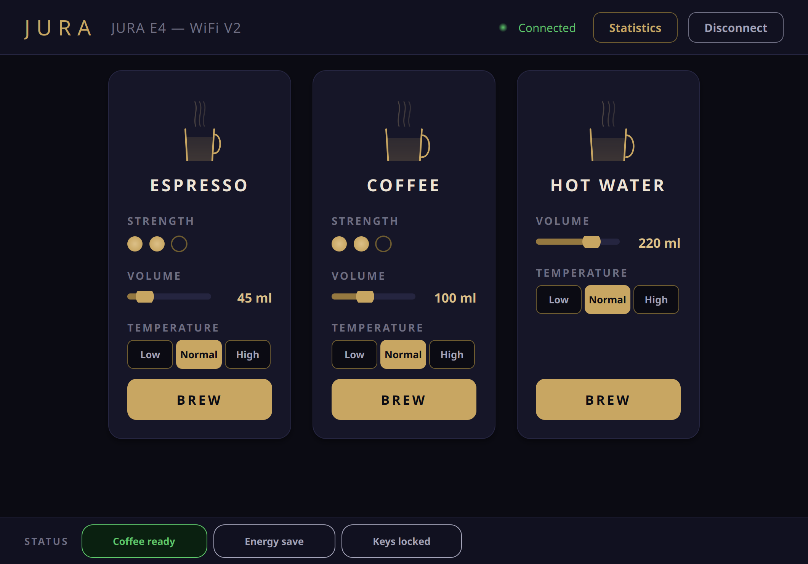
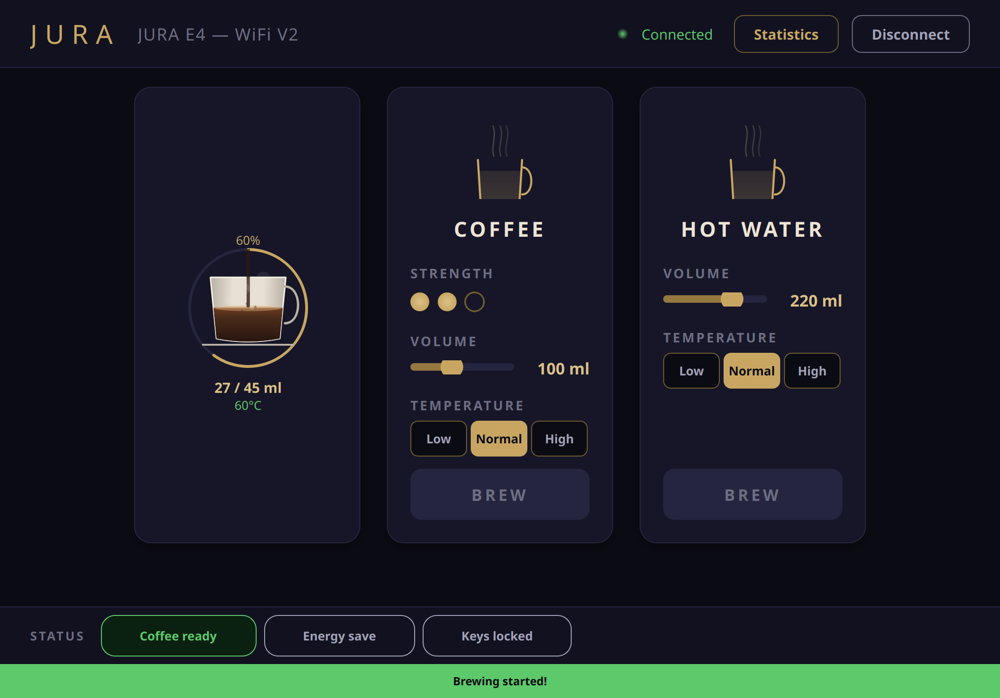
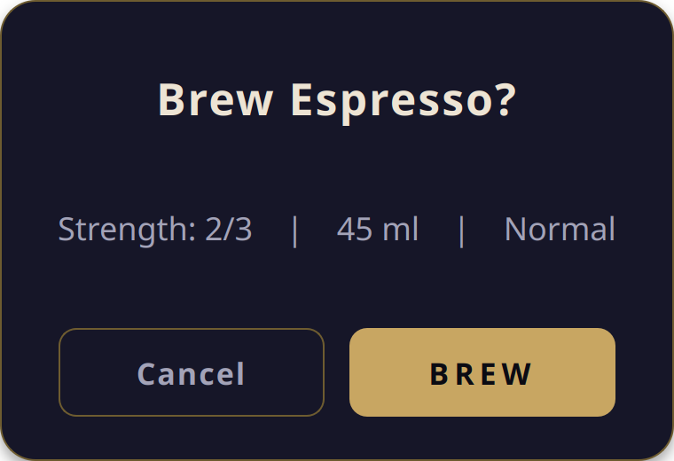
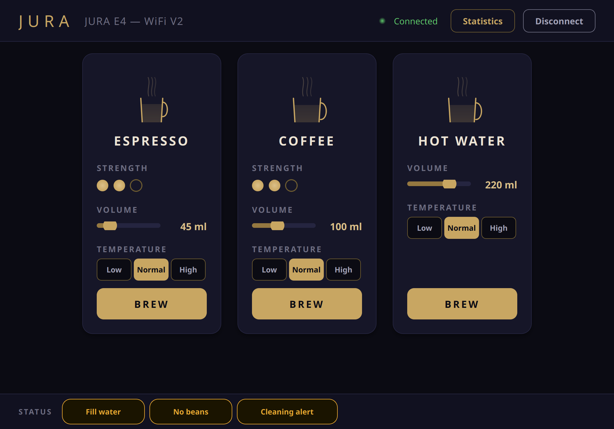
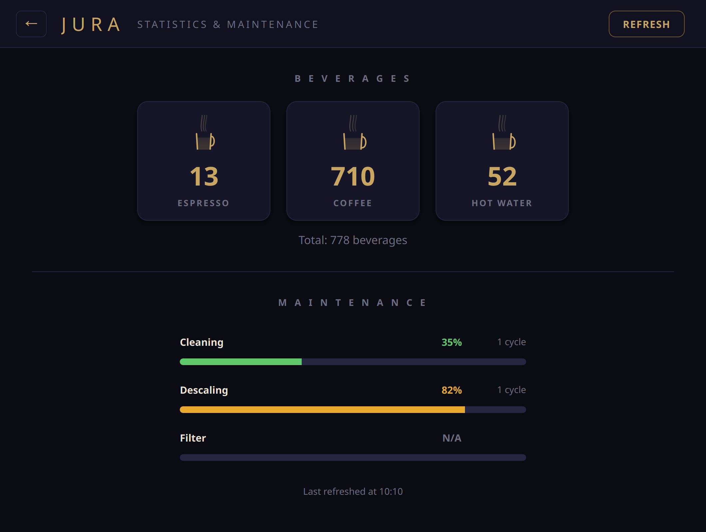
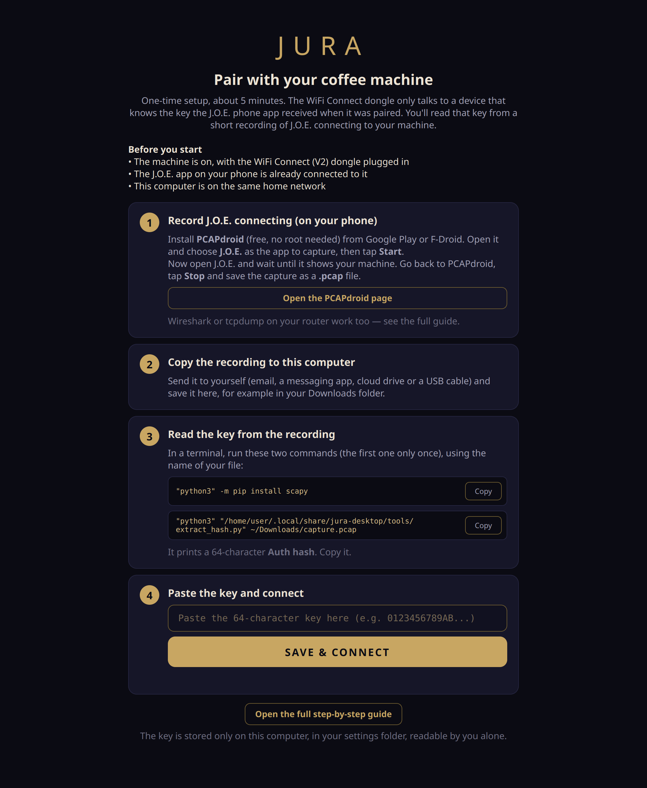

# JURA Desktop Control

A premium Linux desktop app for controlling the **JURA E4** coffee machine through the **WiFi Connect V2** dongle. Reverse-engineered from the official J.O.E. Android app.

## Features

### Brew Control
- **Three products**: Espresso, Coffee, Hot Water
- Adjustable **strength** (1-3), **volume** (slider), and **temperature** (Low/Normal/High)
- Confirmation dialog before every brew (safety)
- **Pre-brew check** — refuses to start (and says why) when the machine reports a blocking alert: no water, no beans, grounds container full, tray/outlet/rear cover missing. Hot water only cares about the ones it needs
- **Live brewing animation** with real-time progress and temperature from the machine. It starts only once the machine has *acknowledged* the brew, so a rejected request never plays a fake animation
- Heating phase detection with pulsing "Heating up..." display
- "Enjoy your coffee!" completion feedback
- Cooldown between brews, measured from when the previous brew *finished*

### Statistics & Maintenance
- **Lifetime product counters** — how many espressos, coffees, and hot waters have been made
- **Maintenance bars** — Cleaning, Descaling, and Filter *wear*: **0% = just serviced, 100% = service due** (green below 75%, amber from 75%, red "due" at 100%; the filter shows N/A on machines without one)
- **Cycle counters** — number of maintenance cycles performed
- Maintenance warnings surface in the dashboard status bar when due; the false "Filter alert" some machines report is hidden when no filter is installed
- Opening Statistics during a brew (or while disconnected) explains why instead of spinning forever

### Connection
- **Auto-connect on launch** — tries saved IP, falls back to UDP discovery
- **Auto-reconnect that never gives up** — after a drop it retries after 2, 5, 10, 20 and 30 s, then every 30 s, so the app is live again by itself when the machine comes back (e.g. after its auto-off); the header shows "Reconnecting..." and later "Machine unreachable — retrying (#N)". **Disconnect** works at any point, including mid-reconnect
- **Fast failure detection** — a closed link is noticed within one poll (~4 s), a silent dongle within ~15 s, and the dongle ending the session (`@TS`, e.g. machine auto-off) immediately — also in the middle of a brew
- **Settings persistence** — dongle IP, brew preferences and the notifications switch saved across sessions
- Clear error messages (e.g. "Close J.O.E. on your phone first" when the dongle is busy). The dongle frees its single connection slot slowly, so refused connects are retried for a few seconds before that message appears

### Desktop Integration
- **System tray** — minimize to tray on close, quick-brew from the tray menu
- **Desktop notifications** (tray menu → *Notifications*, on by default): "Machine needs attention" the moment water/beans/grounds/tray/cleaning/descaling need you (announced once, not every poll), "*Espresso* is ready" and "Brew failed" when the window isn't in front, "Lost connection" if a drop lasts 15 s and "Machine back online" afterwards
- **Single instance** — launching the app again raises the running window (even from the tray) instead of starting a second one that would fight for the dongle's single connection
- **Start at login** (tray menu) — creates `~/.config/autostart/jura-desktop.desktop` and starts minimized in the tray (`run.sh --minimized`)
- Dark theme with gold accents, large high-contrast controls (usable at the 900x680 minimum window size)
- Custom-painted SVG/PNG icons (`icon.svg`, PNGs) — point a `.desktop` file at `run.sh` for a menu launcher

## Screenshots

<p align="center">
  
</p>

**Dashboard** — one card per product with large, high-contrast controls; the status bar at the bottom shows what the machine reports.

<p align="center">
  
</p>

**Live brewing** — the animation follows the real progress and temperature pushed by the machine (27 / 45 ml at 60 % here). It starts only after the machine accepted the brew, and the other cards stay locked meanwhile.

<p align="center">
  
</p>

**Confirmation** — every brew is confirmed first, with the settings spelled out.

<p align="center">
  
</p>

**Needs attention** — blocking alerts show up as amber pills (and as a desktop notification); a brew that the machine could not perform is refused with the reason instead of being sent.

<p align="center">
  
</p>

**Statistics & maintenance** — lifetime counters and service wear (0 % = just serviced, 100 % = due; sample values shown).

<p align="center">
  
</p>

**First-launch guide** — four steps with copy buttons; a connection screen with manual IP entry appears if the dongle can't be found automatically.

The pictures are rendered from the app's own widgets with sample data (no machine needed): `python3 tools/make_screenshots.py` regenerates them into `docs/screenshots/`.

## Requirements

- **Python** 3.10+
- **PyQt5** 5.15+
- **bleak** 3.0+ (BLE library — installed but only used by the reference protocol module)
- **Linux** with a desktop environment (tested on Linux Mint / Cinnamon)
- **JURA WiFi Connect V2 dongle** plugged into the coffee machine
- Machine and computer on the **same local network**

## Installation

### One command (Linux Mint, Ubuntu, Debian — best-effort on Fedora and Arch)

```bash
curl -fsSL https://raw.githubusercontent.com/ovexro/JuraE4/main/install.sh | bash
```

This installs anything missing (`git`, `python3`, `venv`, `pip` — asks for your `sudo` password only if something has to be installed), downloads the app to `~/.local/share/jura-desktop`, sets up its own Python environment with PyQt5, and adds **JURA Desktop Control** to your application menu plus a `jura-desktop` command. Open the app: the first launch walks you through pairing (see below).

Prefer to read the script before running it? `curl -fsSL https://raw.githubusercontent.com/ovexro/JuraE4/main/install.sh -o install.sh`, look at it, then `bash install.sh`. Running it again updates in place and never touches your settings.

To remove everything: `~/.local/share/jura-desktop/uninstall.sh` (keeps your settings and saved key; add `--purge` to delete those too).

> Tested on Linux Mint 22 (Cinnamon). On plain GNOME the tray icon needs the *AppIndicator* extension; without a tray the app still works, but it can't hide in the tray and desktop notifications are unavailable.

### Manual

```bash
git clone https://github.com/ovexro/JuraE4.git
cd JuraE4
python3 -m venv .venv
source .venv/bin/activate
pip install -r requirements.txt
./run.sh
```

## First-time setup (auth hash)

The WiFi Connect V2 dongle only talks to a device that knows the key the **J.O.E. phone app received when it was paired**. This is a one-time setup — you read that key once and the app remembers it. **The app's first-launch screen walks you through exactly these steps** (with copy buttons for the commands); this section is the reference.

### Step 1: Record J.O.E. connecting

You need a capture of the J.O.E. app connecting to your machine. A normal home network is *switched*, so a PC on the same WiFi **cannot see** the traffic between your phone and the dongle — capture it on the phone itself, or on the router.

**Option A — PCAPdroid on your phone (no root)**
1. Install [PCAPdroid](https://github.com/emanuele-f/PCAPdroid) (free; Google Play or F-Droid)
2. In PCAPdroid pick **J.O.E.** as the app to capture and tap **Start**
3. Open J.O.E. and wait until it shows your machine
4. Back in PCAPdroid tap **Stop** and save the capture as a `.pcap` file, then copy it to your computer

PCAPdroid records the phone's own traffic through a local VPN, so it needs no root and sees J.O.E.'s connection to the dongle. *(I used Option B myself; if a PCAPdroid capture contains no traffic to port 51515, use B.)*

**Option B — tcpdump on an OpenWrt router (the method used to develop this app)**
```bash
# SSH into your router
ssh root@192.168.1.1

# Capture traffic to/from the dongle (replace IP if different)
tcpdump -i br-lan -w /tmp/capture.pcap host 192.168.1.105 &

# Open J.O.E. on your phone, let it connect, then:
kill %1
scp root@192.168.1.1:/tmp/capture.pcap .
```

**Option C — a machine that carries the traffic (your router, or a PC acting as the WiFi hotspot / bridge)**
```bash
sudo tcpdump -i <interface> -w capture.pcap port 51515
# Open J.O.E. on the phone, let it connect, then Ctrl+C
```

### Step 2: Extract the hash

```bash
pip install scapy  # one-time dependency
python3 tools/extract_hash.py capture.pcap
```

Output:
```
============================================================
  AUTH HASH FOUND
============================================================

  Device name:  Your Phone
  Auth hash:    0123456789ABCDEF...

  Paste this hash into the JURA Desktop Control app
  when prompted on first launch.
============================================================
```

### Step 3: Paste into the app

On first launch, the app shows the setup guide. Paste the 64-character hash and click **SAVE & CONNECT**. Done — you'll never be asked again. The key is stored in `~/.config/jura-desktop/settings.json`, readable by you alone.

After that the app finds the dongle on your network by itself (UDP discovery, including broadcast); if it can't, the connection screen lets you type the IP address.

## Usage

### Daily use
1. Launch the app — it auto-connects to the dongle (saved IP from last session)
2. If discovery fails, enter the dongle's IP manually (check your router's DHCP leases)
3. Once connected, the IP is saved for next time

### Making coffee
1. Choose a product card (Espresso, Coffee, or Hot Water)
2. Adjust strength, volume, and temperature
3. Click **BREW** and confirm
4. Watch the live brewing animation with real progress from the machine

### System tray
- Closing the window minimizes to the system tray (stays connected)
- Right-click the tray icon for quick-brew shortcuts
- Select **Quit** from the tray menu to fully exit

### Statistics
- Click **Statistics** in the dashboard header
- View lifetime beverage counts and maintenance status
- Click **Refresh** to re-read data from the machine

## Architecture

```
jura_app.py          PyQt5 GUI — all screens, widgets, animations
jura_wifi_v2.py      WiFi V2 protocol client — encryption, auth, commands
jura_protocol.py     BLE protocol module (reference — used for alert definitions)
jura_wifi.py         ESP32 bridge client (legacy, not used)
esp32/               ESP32 MicroPython firmware (legacy, not used)
captures/            Network capture analysis tools
tests/               Offline tests (fake dongle + offscreen GUI), ./tests/run_all.sh
docs/screenshots/    README images, generated by tools/make_screenshots.py
```

### Protocol

The WiFi Connect V2 dongle communicates over **TCP port 51515** with a per-message nibble-substitution cipher. The encryption was reverse-engineered from the decompiled J.O.E. Android APK (`WifiCryptoUtil.java`).

Key commands:
| Command | Purpose |
|---------|---------|
| `@HP:` | Authentication (static hash per dongle) |
| `@TS:01/00` | Start/stop session |
| `@TG:C0` | Maintenance wear: cleaning / filter / descaling (0 = just serviced, 100 = due, 255 = n/a) |
| `@TG:43` | Maintenance counters |
| `@TR:32,XX` | Product counters (lifetime totals) |
| `@TP:` | Brew command (product, strength, volume, temperature) |
| `@TV:` | Brew progress push (real-time % and temperature) |
| `@TF:` | Machine status bitmask (40+ alerts), pushed with every poll |
| `@TS` (push) | Dongle ended the session (seen right after the machine's auto-off) |

The dongle handles all machine-level serial encryption internally — the desktop app only needs the WiFi-layer cipher.

### Threading Model

- **Main thread**: Qt event loop (GUI rendering, signal dispatch); it never blocks on the network — connect, disconnect, statistics and brew all run on worker threads
- **WiFiV2Manager**: daemon threads for status polling (every ~4 s), brew progress, statistics reading
- **Communication**: Qt signals with automatic cross-thread queuing
- **Safety**: `threading.Lock` for connection state (never held while waiting or while emitting a signal), `_sock_lock` for socket send/recv atomicity
- **Receive path**: `_recv_all(timeout, expect=<reply prefix>)` waits for the awaited reply, then only a 50 ms grace for messages the dongle bundles with it (the dongle answers a status poll with `@TF` at once and `@tg` ~200 ms later)

## Configuration

Settings are stored in `~/.config/jura-desktop/settings.json`:

```json
{
  "dongle_ip": "192.168.1.105",
  "notifications": true,
  "product_espresso": {"strength": 2, "volume": 45, "temperature": 1},
  "product_coffee": {"strength": 2, "volume": 100, "temperature": 1},
  "product_hot water": {"volume": 220, "temperature": 1}
}
```

## Limitations

- **Single connection**: The WiFi V2 dongle accepts only one TCP connection at a time. Close the J.O.E. phone app before using the desktop app.
- **E4 only**: Tested exclusively on the JURA E4. Other JURA models may work if they use the same WiFi Connect V2 dongle, but product codes and register layouts will differ.
- **No BLE brewing**: The BLE Smart Connect dongle works for status reading but rejects brew commands from Linux (BlueZ ATT limitation). WiFi V2 is the only working brew path.

## Disclaimer

This project is an independent, personal work created for educational and interoperability purposes. It is **not affiliated with, endorsed by, or associated with JURA Elektroapparate AG** or any of its subsidiaries. "JURA", "J.O.E.", and "WiFi Connect" are trademarks of JURA Elektroapparate AG.

The communication protocol was reverse-engineered under the right to interoperability as provided by EU Directive 2009/24/EC (Article 6) and applicable fair-use principles, for the sole purpose of enabling a Linux desktop client to communicate with hardware owned by the user.

No proprietary source code, binaries, or assets from JURA are included in this repository.

## License

Private — not for redistribution.

## Credits

- Protocol reverse-engineering: decompiled from the [J.O.E.](https://play.google.com/store/apps/details?id=ch.toptronic.joe) Android app
- Built with [Claude Code](https://claude.ai/code) (Claude Opus 4.6; later audit and hardening pass with Claude Sonnet 5.5)
